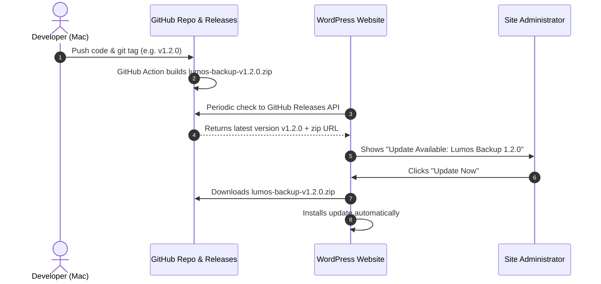

# Lumos Backup 🛡️

**Emergency-resilient WordPress backups paired with an autonomous standalone restore console that runs even when WordPress will not boot.**

---

## 🚀 How to Update & Push from Your Mac

When you make code changes on your Mac, follow these simple steps to push updates to GitHub so connected WordPress websites automatically receive the update notification.

### Quick 3-Step Release Workflow

1. **Update Version**:
   - In `lumos-backup.php`, bump the version number:
     ```php
     * Version: 1.2.0
     ...
     define( 'LUMOS_BACKUP_VERSION', '1.2.0' );
     ```
   - In `readme.txt`, update `Stable tag: 1.2.0`.
   - Add a brief note under `CHANGELOG.md`.

2. **Build Installable Zip (Optional / Local)**:
   ```bash
   ./scripts/build-release.sh
   ```
   *This automatically verifies syntax and generates `lumos-backup-v1.2.0.zip` ready to install.*

3. **Commit, Tag & Push to GitHub**:
   ```bash
   git add .
   git commit -m "Release v1.2.0 - Added new feature"
   git tag v1.2.0
   git push origin main --tags
   ```

---

## ⚡ How WordPress Receives Updates

Lumos Backup includes an automatic GitHub update checker (`includes/class-updater.php`).



1. When you push tag `v1.2.0`, GitHub Actions automatically packages `lumos-backup-v1.2.0.zip` and attaches it to the GitHub Release.
2. WordPress checks GitHub periodically (or when clicking **Check Again** under **Dashboard → Updates**).
3. When a new version is detected, WordPress displays the native **"Update Available"** badge under **Plugins**.
4. The administrator clicks **Update Now**, and WordPress downloads and installs `lumos-backup-v1.2.0.zip` in one click.

---

## 📦 Ready-to-Install ZIP Files

Whenever you need a standalone `.zip` file to send to a client or upload manually:
- Run `./scripts/build-release.sh` on your Mac.
- The output zip is saved with the standard naming convention:
  `lumos-backup-v1.1.0.zip`
- The zip has the correct WordPress directory structure:
  ```text
  lumos-backup-v1.1.0.zip
  └── lumos-backup/
      ├── lumos-backup.php
      ├── includes/
      ├── restore/
      ├── readme.txt
      ├── CHANGELOG.md
      └── README.md
  ```

---

## 🛠️ WP-CLI Commands Reference

You can manage Lumos Backup directly from the command line:

```bash
# Create a new backup snapshot
wp lumos backup

# Create an encrypted backup
wp lumos backup --encrypt --passphrase="my-secret-password"

# List all local, S3, and SFTP archives
wp lumos list

# Run an isolated restore drill verifying integrity
wp lumos drill

# Restore a backup snapshot
wp lumos restore backup-20261116-114200.zip --yes

# Restore with domain change (serialized-safe)
wp lumos restore backup-20261116-114200.zip --new-siteurl=https://newsite.com --yes

# View status & recovery link
wp lumos status

# Rotate the emergency restore token
wp lumos token --rotate
```

---

## 🚨 Emergency Standalone Restore (`lumos-restore.php`)

If WordPress crashes, throws a white screen of death, or has database connection failures:
1. Visit your emergency restore link:
   `https://yoursite.com/lumos-restore.php?k=YOUR_SECRET_TOKEN`
2. This standalone UI runs purely on PHP and MySQL—completely independent of WordPress core.
3. Select any local, S3, or SFTP backup to restore your site in two clicks.
